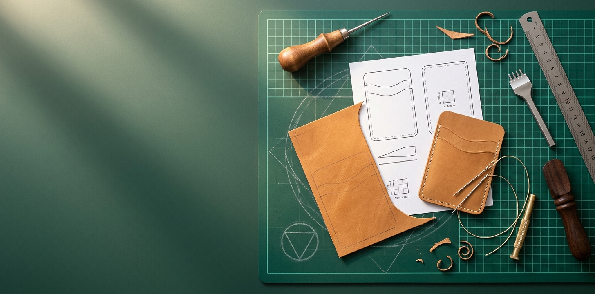

<p align="center"></p>

# Awlchemy

**Turn any leather pattern into a project you can actually finish.**

A leathercraft workshop on your own computer. All your PDF patterns go into one searchable library, and **the Awlchemist**, a Claude-powered teacher, turns each pattern into a build guide a beginner can follow.

**[Try the demo in your browser](https://silentthread404.github.io/awlchemy/)**. It uses made-up patterns and pre-written answers, and nothing is installed or saved.

Plug in your own patterns: a shared Google Drive folder, a folder on your computer (Dropbox, OneDrive, a USB stick, a NAS), or PDFs you drop in or link to. Nothing about your patterns is stored in this repository.

## What it does

- **Keeps your pattern sources in sync.** Add as many sources as you like. Each one is mirrored into its own folder in `library/`, and later checks only fetch new files.
  - **Google Drive folder** shared as "Anyone with the link". No Google login or API key is needed.
  - **Local or network folder.** New and changed PDFs/ZIPs are copied in.
- **Builds a library you can browse.** Every PDF gets:
  - a cover image
  - a difficulty, taken from folders named like `1. EASY`, `2. MEDIUM`, `3. HARD`, `4. VERY HARD`
  - its collection (the folder it's in)
  - full-text search
  
  Text PDFs are also converted to Markdown for a readable *Instructions* tab. A pattern that ships its pieces in several paper sizes (A4, Letter, A1…) shows as one card, and you pick the size when you print. You can rename a pattern and set its difficulty yourself.
- **Lets you add single patterns.** Drop in PDF/ZIP files, or paste a link: a Drive file, a direct PDF link, or a web page that links to PDFs. They go into `library/Imported/`.
- **Writes a build guide per pattern.** Claude looks at every page, drawings included, and writes:
  - which leather to use for each part, with tannage, thickness in mm and oz, and the reason
  - every tool, marked as *have it* or *need it* against your toolkit, with substitutes
  - hardware, thread and finishing products
  - each step rewritten for a beginner, with tips, the mistakes to avoid, and a progress checklist
  - the places where the pattern is vague, and how to handle them
- **Shows YouTube videos for each technique** a pattern uses (saddle stitch, burnishing, setting rivets…). Only links that really came back from a search are kept. Videos are stored per technique, so the next pattern that needs them reuses them.
- **Gives you the Awlchemist to ask,** per pattern or in general. It can find shops that ship to you, look at a photo of your work and give feedback, and suggest your next project from your own library.
- **Prints from the original.** The printable pattern always comes from the untouched PDF. Print at **100% / Actual size** and check the calibration square.

## Requirements

- Windows, macOS or Linux, with [uv](https://docs.astral.sh/uv/) (it installs Python 3.13 for you).
- [Claude Code](https://claude.com/claude-code), signed in with your Claude account. The teacher runs through Claude Code on your computer, so there's no API key, and usage counts against your Claude plan.
  The library, sync and import all work without it; only guides, videos and the teacher need it.

## Getting started

1. Install uv:
   - Windows: `powershell -c "irm https://astral.sh/uv/install.ps1 | iex"`
   - macOS/Linux: `curl -LsSf https://astral.sh/uv/install.sh | sh`
2. Install Claude Code, run `claude` once in a terminal and sign in with `/login`.
3. Get the code: `git clone <this repo>`, then `cd awlchemy`.
4. Start the app: double-click **`run.bat`** on Windows, or run `uv run awlchemy`. It opens http://127.0.0.1:8765.
5. In **Settings**:
   - Add a **pattern source**: a shared Drive folder link or a folder path.
   - Click **Test the connection** for Claude Code.
   - Tick the tools you own.

## Command line

```
uv run awlchemy                                  # start the app
uv run awlchemy source add "My patterns" "https://drive.google.com/drive/folders/…"
uv run awlchemy source add "Dropbox" "D:\Dropbox\Leather patterns"
uv run awlchemy source list
uv run awlchemy source remove "Dropbox" [--delete-files]   # --delete-files also takes its patterns out of the library
uv run awlchemy sync --dry-run                   # what's new, without downloading
uv run awlchemy sync [--source "My patterns"]    # fetch new files, then index
uv run awlchemy index                            # re-scan library/ after copying PDFs in by hand
uv run awlchemy import <link|file> --collection "Etsy wallets"
```

`sync.bat` runs `sync` without the app, which is handy for a nightly Windows Task Scheduler job.

## Where things live

```
library/<source name>/   one mirrored folder per source (don't rename things in here)
library/Imported/        patterns you added through Import
data/awlchemy.db         library index, guides, notes, progress, chats
data/settings.json       your sources, model, toolkit, preferences
data/knowledge/*.md      optional extra notes the teacher should know (yours, not shared)
data/thumbs, data/markdown, data/pages   generated previews and text
```

`library/` and `data/` are git-ignored. Your patterns, source links and settings stay on your computer.

## How the AI part works

Guides, chats and video searches run as Claude Code sessions through the [Claude Agent SDK](https://docs.claude.com/en/docs/agent-sdk/overview).

The app renders every page of a pattern to an image and points Claude at those images plus the Markdown text, so Claude sees the drawings as well as the words.

Each session can only read files and search the web. It can't run commands or change files, and it doesn't load your own Claude Code settings, plugins or MCP servers. A pattern or web page can't talk Claude into more than that either. It can only open your patterns, their page images and your chat photos, never your settings or other files on the computer. It also can't fetch anything on your own computer or home network.

You pick the model in Settings. Opus writes the most careful guides but uses your plan's limits fastest; Haiku uses the least.

## The demo site

`demo/` holds a static version of the app for GitHub Pages: the real frontend, with `demo/demo.js` standing in for the server. Everything in it is invented for the demo.

```
python demo/build.py                                  # writes demo/_site/
python -m http.server 8799 --directory demo/_site     # then open http://127.0.0.1:8799
```

To publish it from your own fork, choose **Settings → Pages → Source: GitHub Actions** once. The `Demo site` workflow then deploys on every push to `main` that touches the frontend or `demo/`.

## Respect pattern licences

Awlchemy only organises patterns **you have the right to use**. Don't commit pattern PDFs, links to paid folders, or text copied from paid patterns to this repository or to issues. Shared Drive links are often personal to the buyer, so keep them in your local settings.

## Contributing

Bug reports and pull requests are welcome; see [CONTRIBUTING.md](CONTRIBUTING.md). Run the tests with `uv run pytest`. They need no network access, no Claude Code and no real patterns.

## Licence

Awlchemy is free software under the **GNU Affero General Public License v3.0 or later** (see [LICENSE](LICENSE)). It uses [PyMuPDF](https://pymupdf.readthedocs.io/), which is AGPL-licensed. You may use, change and share Awlchemy, but if you distribute it or run a modified version as a network service, you must share your source under the same licence.

Awlchemy is an independent project. It isn't affiliated with Anthropic, Google or any pattern seller.
